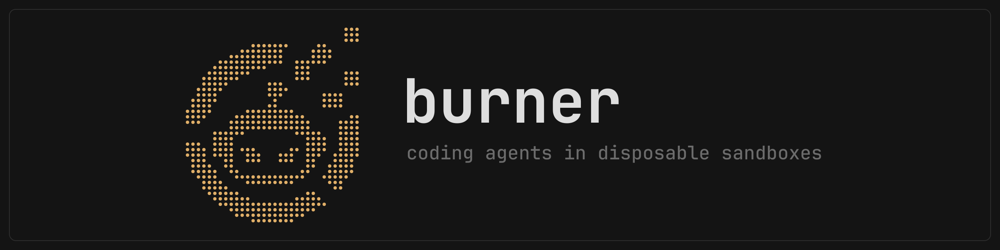
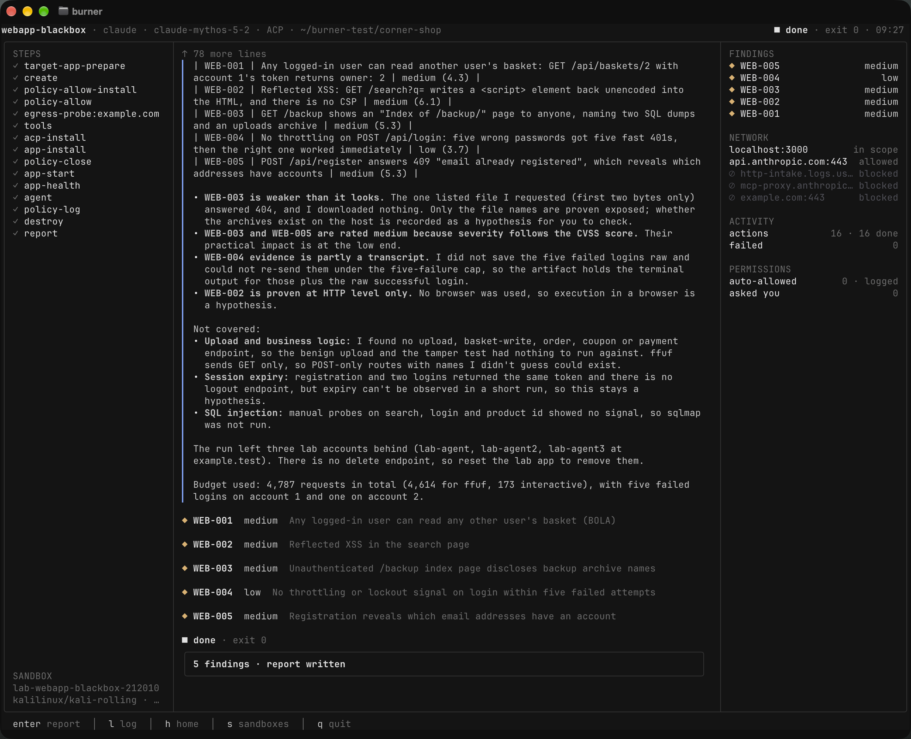
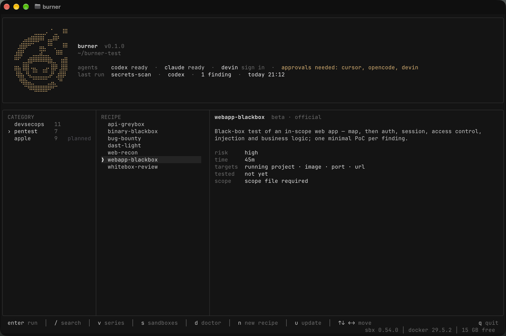
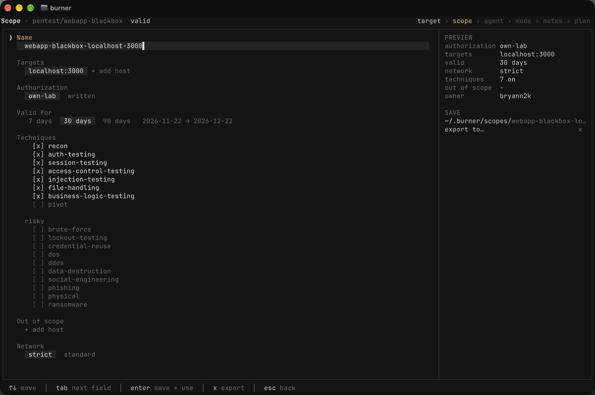
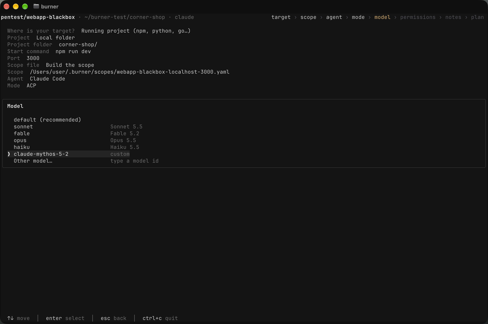
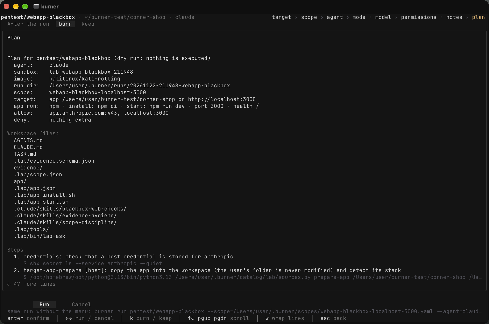

<p align="center"></p>

**burner runs coding agents inside disposable Docker Sandboxes to work through security recipes, and hands you a report with proof.**

- **Recipes.** 11 DevSecOps and 7 pentest recipes: pick one, give it a target and a scope, get findings.
- **Sandboxes.** Each run lives in its own `sbx` VM. Burn it when the run ends, or keep it to look around.
- **Subscriptions, not API keys.** You sign in once through `sbx run <agent>`. Credentials stay on the host.
- **One TUI.** Setup, scope, agent, model, plan, live view and reports all happen in `burner`. Every screen has a CLI equivalent.

## Install

```sh
curl -fsSL https://raw.githubusercontent.com/BRYANN2K/sbx-burner/main/install.sh | sh
burner
```

The script checks the cosign signature and the sha256 before it installs. Other options: [docs/install.md](docs/install.md).

Requirements:

- macOS or Linux, arm64 or amd64.
- [Docker Sandboxes (`sbx`)](https://docs.docker.com/ai/sandboxes/install/).
- python3 3.11 or newer and git. The setup screen checks for them.

The first `burner` launch opens setup. It checks the machine, connects your agents and saves your defaults.

## Tour

### Live run



Steps, agent activity, findings, and which hosts are in scope or blocked, all in one view.

### Home



Categories, recipes and the status of each agent.

### Scope



Targets, authorization, allowed techniques, and a separate group for risky ones.

### Flow



Target, scope, agent, mode, model, permissions, notes, then plan.

### Plan



A dry run of every step before anything runs. Choose burn or keep for the sandbox afterwards.

## Recipes

Linux variants are beta. macOS variants are planned.

| Category | Recipe | What it does |
| --- | --- | --- |
| pentest | `web-recon` | Maps the attack surface of in-scope web hosts. |
| pentest | `webapp-blackbox` | Black-box test of a web app: auth, session, access control, injection. |
| pentest | `api-greybox` | Grey-box API test with two users; proves broken authorization. |
| pentest | `whitebox-review` | Source review with reachability, a trace and a fix diff per finding. |
| pentest | `dast-light` | Passive ZAP baseline scan, then manual confirmation of each alert. |
| pentest | `binary-blackbox` | Black-box analysis of a Linux binary. |
| pentest | `bug-bounty` | Authorized testing of one bug-bounty program. |
| devsecops | `secrets-scan` | Finds leaked credentials in a repo and its history with gitleaks. |
| devsecops | `sast-semgrep` | Static analysis with semgrep; every hit is checked against the code. |
| devsecops | `sca-osv` | Known dependency vulnerabilities from lockfiles with osv-scanner. |
| devsecops | `container-scan` | Scans a Dockerfile context or image with trivy and grype. |
| devsecops | `iac-scan` | Terraform, Kubernetes and Dockerfile misconfigurations. |
| devsecops | `sbom-sign` | CycloneDX and SPDX SBOMs, signed with a throwaway cosign key. |
| devsecops | `license-compliance` | Checks SBOM licences against an allow, review and deny policy. |
| devsecops | `supply-chain-risk` | Dependency risk: install scripts, floating versions, look-alikes. |
| devsecops | `pr-security-review` | Reviews a pull request diff; reports only proven issues. |
| devsecops | `fuzzing` | Fuzzes C and Go harnesses, then dedupes and classifies crashes. |
| devsecops | `gate` | Runs secrets, SCA, SAST, IaC and licence checks; decides pass or fail. |

Nine `apple` recipes (iOS audit, Mach-O triage, Xcode CI and others) are planned and need [macsbx](https://github.com/BRYANN2K/macsbx). Details: [docs/roadmap.md](docs/roadmap.md).

## Agents

Sign in once with `sbx run <agent> <folder>`, then quit. sbx keeps the credential on the host.

| Agent | Sign-in | ACP live view |
| --- | --- | --- |
| claude | `sbx run claude <folder>`, with your plan | yes |
| codex | `sbx run codex <folder>`, with your plan | yes |
| cursor | `sbx run cursor <folder>`, with your plan | yes |
| devin | `sbx run devin <folder>` | yes |
| opencode | `sbx run opencode <folder>`, providers set in OpenCode | yes |

Pass `--acp` to drive the agent over the Agent Client Protocol. `burner acp agents` lists the wired agents. Devin keeps a real token inside the sandbox; read [Scope and safety](docs/scope-and-safety.md#credentials) first.

## Safety

- Pentest recipes need a scope file. burner refuses to start without one.
- The scope says `own-lab` or `written` authorization. A third-party target needs a written reference.
- The sandbox network is deny-all. Only the scope hosts and the agent's API host are allowed.
- Secrets stay in sbx. The sandbox sees a placeholder.
- burner never writes sbx credentials.
- Findings need evidence: a command, its output, a file.

Use burner for defensive work and authorized testing only. Full rules: [docs/scope-and-safety.md](docs/scope-and-safety.md).

## CLI

The plan screen prints the exact command for the run you configured. A few more:

```sh
burner run pentest/webapp-blackbox --scope scope.yaml --agent claude
burner run devsecops/secrets-scan --target . --dry-run
burner run devsecops/gate --target . --keep --acp
burner list
burner scope scope.yaml --host app.example.com
burner sandboxes
burner burn --kept
burner doctor
burner update
```

`burner --help` lists every flag.

## Docs

- [Getting started](docs/getting-started.md)
- [Install](docs/install.md)
- [Scope and safety](docs/scope-and-safety.md)
- [Live runs](docs/live-runs.md)
- [Recipe format](docs/recipe-format.md) and [writing a recipe](docs/writing-a-recipe.md)
- [Evidence and reports](docs/evidence-and-reports.md)
- [Roadmap](docs/roadmap.md)

## Project

- [Contributing](CONTRIBUTING.md): Conventional Commits and a DCO sign-off.
- [Security policy](SECURITY.md): acceptable use and how to report a vulnerability.
- [Code of conduct](CODE_OF_CONDUCT.md).
- License: [Apache-2.0](LICENSE).
